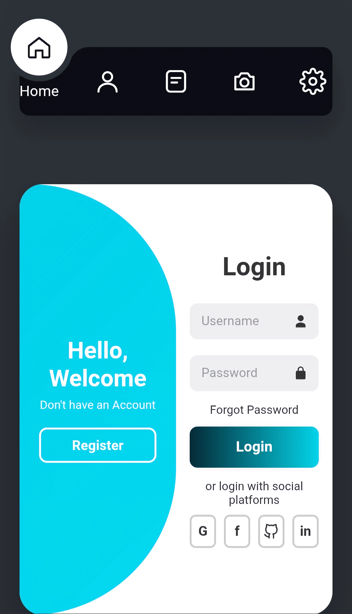
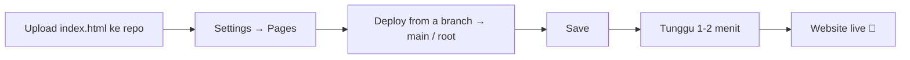

<div align="center">

  # 💧 LIQUID UI
  ### ⚡ Kumpulan Komponen UI Web · Animasi Halus · HTML + CSS + JS Murni ⚡

  [](#-tech-stack--teknologi)
  [](#-tech-stack--teknologi)
  [](#-tech-stack--teknologi)
  [](#-tech-stack--teknologi)
  [](#-lisensi)
  [](#)

  <p align="center">
    <a href="https://morelaa.github.io/liquid-ui/">
      
    </a>
  </p>

  <p align="center">
    <a href="https://morelaa.github.io/liquid-ui/">
      
    </a>
  </p>

  <p align="center">
    <b>Koleksi komponen antarmuka web dalam satu file <code>index.html</code>, tanpa framework dan tanpa library.</b>
    <br />
    <i>15 komponen interaktif: navigasi liquid, sidebar, login slider, dropdown, kartu 3D, glassmorphism, neumorphism, dan dukungan mode gelap.</i>
  </p>

  ---

  [🌐 Live Demo](https://morelaa.github.io/liquid-ui/) •
  [🛠️ Tech Stack](#-tech-stack--teknologi) •
  [✨ Fitur Unggulan](#-fitur-unggulan) •
  [🧱 Daftar Komponen](#-daftar-komponen) •
  [📂 Struktur Project](#-struktur-project) •
  [🚀 Cara Pakai](#-cara-pakai) •
  [🌐 Deploy GitHub Pages](#-deploy-ke-github-pages) •
  [🎨 Kustomisasi](#-kustomisasi)

</div>

<br />

---

## 🛠️ Tech Stack & Teknologi

<p align="center">
  
  
  
  
  
</p>

| Komponen | Teknologi | Deskripsi |
| :--- | :--- | :--- |
| **Struktur** | `HTML5` | Satu file `index.html`, semua komponen di satu halaman |
| **Styling** | `CSS3` | Flexbox, grid, CSS variable, transition, `backdrop-filter`, `perspective` 3D |
| **Interaksi** | `JavaScript` vanilla | Toggle class, event listener, filter pencarian, efek tilt mengikuti kursor |
| **Ikon** | `SVG` inline | Semua ikon digambar langsung di HTML, tanpa icon font dan tanpa request tambahan |
| **Tema** | `prefers-color-scheme` | Mode gelap otomatis mengikuti pengaturan perangkat |
| **Hosting** | `GitHub Pages` | Gratis, langsung tampil sebagai website |

<br />

---

## 🌟 Fitur Unggulan

<table>
  <tr>
    <td width="50%">
      <h3>🪶 Nol Dependensi</h3>
      <p>Tidak ada <code>npm install</code>, tidak ada CDN, tidak ada font eksternal. Cukup satu file, buka di browser, langsung jalan.</p>
    </td>
    <td width="50%">
      <h3>💧 Animasi Liquid</h3>
      <p>Indikator navigasi yang meluncur dengan lekukan cair, blob menu yang berpindah, dan panel login yang bergeser dengan transisi berurutan.</p>
    </td>
  </tr>
  <tr>
    <td width="50%">
      <h3>📱 Responsif & Touch Friendly</h3>
      <p>Layout fleksibel sampai lebar HP, efek hover punya padanan <code>:active</code> untuk layar sentuh, dan memakai safe-area untuk perangkat berponi.</p>
    </td>
    <td width="50%">
      <h3>🌙 Mode Gelap Otomatis</h3>
      <p>Warna diatur lewat CSS variable dan otomatis berubah saat perangkat memakai mode gelap. Sidebar dashboard juga punya toggle dark mode sendiri.</p>
    </td>
  </tr>
  <tr>
    <td width="50%">
      <h3>🧊 Glass & Neumorphism</h3>
      <p>Kartu kaca dengan blur, serta tombol neumorphism dengan efek timbul dan tenggelam saat diaktifkan.</p>
    </td>
    <td width="50%">
      <h3>🔍 Pencarian Interaktif</h3>
      <p>Search bar yang melebar saat diklik, plus dropdown pencarian dengan highlight teks yang cocok secara real-time.</p>
    </td>
  </tr>
</table>

<br />

---

## 🧱 Daftar Komponen

| # | Komponen | Kategori | Interaksi |
|:-:|---|---|---|
| 1 | **Liquid Navigation** | Navigasi | Klik menu, indikator lingkaran berpindah |
| 2 | **Login / Registration Slider** | Form | Klik tombol, panel bergeser |
| 3 | **Social Buttons** | Tombol | Hover, efek 3D dan tooltip |
| 4 | **Sidebar UI** | Navigasi | Tombol buka/tutup |
| 5 | **Search Bar Expand** | Input | Klik, melebar |
| 6 | **Search Dropdown** | Input | Ketik, hasil dan highlight |
| 7 | **Card Stack** | Kartu | Klik, kartu berganti |
| 8 | **Profile Card 3D** | Kartu | Miring mengikuti kursor/sentuhan |
| 9 | **Liquid List Menu** | Navigasi | Hover/klik, blob berpindah |
| 10 | **Flip Menu** | Navigasi | Hover/klik, putar 3D |
| 11 | **Profile Card + Social** | Kartu | Klik, ikon sosial menyebar |
| 12 | **Neumorphism Buttons** | Tombol | Klik, toggle timbul/tenggelam |
| 13 | **Profile Dropdown** | Menu | Klik, buka/tutup |
| 14 | **Glass Cards** | Kartu | Hover, kartu merapat lalu meregang |
| 15 | **Sidebar Dashboard** | Navigasi | Collapse dan dark mode |

<br />

---

## 📂 Struktur Project

```text
📦 liquid-ui
 ├── 📄 index.html    # 🚀 Semua komponen (HTML + CSS + JS dalam satu file)
 └── 📄 README.md     # 📖 Dokumentasi ini
```

> Kalau nanti proyeknya membesar, bagian `<style>` dan `<script>` bisa dipisah ke `style.css` dan `script.js`.

<br />

---

## 🚀 Cara Pakai

### 1. Download atau Clone
```bash
git clone https://github.com/Morelaa/liquid-ui.git
cd liquid-ui
```

### 2. Buka di Browser
Klik dua kali `index.html`, atau jalankan server lokal:
```bash
# opsional, kalau mau pakai server lokal
npx serve .
```

### 3. Ambil Komponen yang Dibutuhkan
Salin blok HTML, CSS, dan JS dari komponen yang kamu mau ke proyekmu sendiri.

> Tidak ada langkah build. Tidak perlu install apa pun.

<br />

---

## 🌐 Deploy ke GitHub Pages



Hasil akhirnya bisa dibuka di:

👉 **[https://morelaa.github.io/liquid-ui/](https://morelaa.github.io/liquid-ui/)**

<br />

---

## 🎨 Kustomisasi

Warna utama diatur lewat CSS variable di bagian atas `<style>`:

```css
:root {
  --page-bg: #7d838c;     /* warna latar halaman */
  --primary-bg: #12121f;  /* warna dasar komponen */
  --circle: #fff;         /* warna indikator navigasi */
}
```

Ubah nilainya untuk mengganti tema seluruh komponen. Untuk mode gelap, atur ulang variabel yang sama di dalam blok `@media (prefers-color-scheme: dark)`.

<br />

---

## 🤝 Kontribusi

Saran dan perbaikan sangat diterima. Silakan buat *issue* atau *pull request*.

<br />

---

## 📜 Lisensi

MIT

<div align="center">
  <sub>Built with 💧 by <a href="https://github.com/Morelaa">Morelaa</a></sub>
</div>
